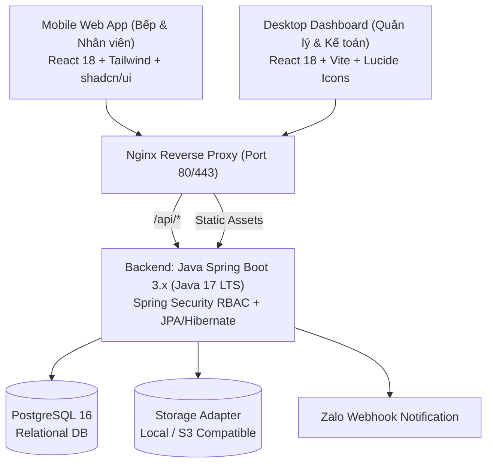

# AGENTS.md — Quy Chuẩn & Hướng Dẫn Phát Triển Cho AI Agents

> **Dự án**: Hệ thống Quản trị Kho Bếp, Nhân sự & Chống Thất Thoát (Sen Việt Buffet)  
> **Chủ đầu tư**: Công ty TNHH T&T Nguyễn Dương (Đại diện: Chị Thêm)  
> **Chi nhánh ban đầu**: 2 Chi nhánh (Thái Nguyên & Quế Võ)  
> **Tài liệu kỹ thuật**: [AGENTS.md](file:///run/media/tamdae/Data/Source%20code/restaurant_project/AGENTS.md)  
> **Tài liệu doanh nghiệp nội bộ (Đã ẩn khỏi Git)**: `implement_demo_plan.md`, `QUESTIONS_FOR_CLIENT.md`, `doc_content.txt`, `BaoGia_*.pdf`

---

## 1. Mục Đích & Nguyên Tắc Hoạt Động (Mission & Core Principles)

Mục tiêu tối thượng của dự án là **xóa bỏ hoàn toàn thất thoát nguyên vật liệu tại kho bếp**, tối ưu hóa thao tác vận hành cho nhân viên bếp trên thiết bị di động, tự động hóa việc đối soát số liệu bán hàng từ CukCuk POS, và quản trị nhân sự - chấm công GPS - tiền lương minh bạch.

### 5 Nguyên tắc cốt lõi AI Agent bắt buộc phải tuân thủ:
1. **Đơn giản hóa tuyệt đối cho nhân viên Bếp (Mobile-first)**: Giao diện bếp chỉ thao tác bằng các nút bấm lớn (tối thiểu 48px), màu sắc nhận diện rõ ràng, tích hợp camera scan mã vạch và tự động nén ảnh trên trình duyệt.
2. **Chống thất thoát bằng dữ liệu chặt chẽ**: Không cho phép tạo số liệu ảo. Mọi thao tác xuất kho, cân mẻ, báo hỏng, ra line đều phải có timestamp, user thực hiện và audit trail.
3. **Phân quyền nghiêm ngặt (RBAC 5 vai trò)**: Mọi endpoint và UI action phải được kiểm tra quyền hạn rõ ràng, không được rò rỉ dữ liệu giữa 2 chi nhánh.
4. **Không ngắt quãng luồng vận hành**: Thiết kế API có tính chịu lỗi cao, xử lý chống bấm đúp (idempotency), và hỗ trợ lưu tạm khi mạng chập chờn.
5. **Code chuẩn mực Enterprise**: Tuân thủ Clean Code, TDD cho các công thức tài chính/kho, viết unit test đầy đủ, cấu trúc layered architecture rõ ràng.

---

## 2. Quy Chuẩn Bảo Mật Dữ Liệu Doanh Nghiệp (Enterprise Confidentiality & Git Security)

> [!CAUTION]
> **QUY TẮC BẤT KHẢ XÂM PHẠM VỀ BÍ MẬT KINH DOANH:**  
> Toàn bộ tài liệu nghiệp vụ, báo giá, hợp đồng, danh sách nhân sự thực tế, dữ liệu kiểm kho thật, doanh thu từ CukCuk POS, ngân hàng đề thi nội bộ... **TUYỆT ĐỐI KHÔNG ĐƯỢC PHÉP COMMIT LÊN GITHUB HOẶC BẤT KỲ MÔI TRƯỜNG CÔNG KHAI NÀO**.

### Quy định bắt buộc đối với AI Agent:
1. **Nhận diện tài liệu doanh nghiệp**:
   * Bất kỳ file nào có định dạng: `*.pdf`, `*.docx`, `*.doc`, `*.pptx`, `*.xlsx`, `*.xls`, `*.csv`.
   * Các file chứa tên đối tác, hợp đồng, báo giá, câu hỏi khảo sát: `BaoGia*`, `HopDong*`, `BienBan*`, `QUESTIONS_FOR_CLIENT*`, `doc_content*`, `plan*`.
   * Các thư mục chứa tài liệu nội bộ: `docs/internal/`, `docs/business/`, `docs/client/`, `docs/contracts/`, `docs/quotes/`, `internal_docs/`.
2. **Hành động tự động khi phát hiện tài liệu doanh nghiệp mới**:
   * Khi người dùng tải lên hoặc Agent tạo ra một tài liệu mới mang tính chất doanh nghiệp/nội bộ, Agent **phải lập tức kiểm tra và bổ sung mẫu file vào [.gitignore](file:///run/media/tamdae/Data/Source%20code/restaurant_project/.gitignore)**.
   * Luôn di chuyển hoặc hướng dẫn người dùng lưu tài liệu đó vào các thư mục đã được ignore (như `docs/internal/`).
3. **Kiểm tra trước khi commit (Pre-commit Audit)**:
   * Trước mỗi thao tác `git add` hoặc `git commit`, Agent **bắt buộc phải chạy `git status`** để rà soát. Nếu thấy bất kỳ file tài liệu nội bộ hoặc file secret/credentials nào đang nằm ở trạng thái `untracked` hoặc `staged`, phải gỡ bỏ ngay lập tức và đưa vào `.gitignore`.
4. **Bảo mật bí mật cấu hình (Zero Secrets in Git)**:
   * Tuyệt đối không commit file `.env`, file chứng chỉ SSL (`*.pem`, `*.key`, `*.crt`), JWT secret key, Zalo Webhook secret token, mật khẩu cơ sở dữ liệu.
   * Chỉ commit file mẫu `.env.example` với các giá trị giả lập/placeholder.

---

## 3. Quy Chuẩn Code Sạch, Đơn Giản & Comment Rõ Ràng (Clean Code & Documentation Rules)

Mã nguồn phải được viết theo tiêu chí **"Sạch - Đơn giản - Dễ đọc - Dễ bảo trì"**, có khả năng tự giải thích cao và có chú thích (comment) chuẩn mực:

### 3.1. Nguyên tắc Đơn giản hóa (KISS & YAGNI)
* **Không Over-Engineering**: Không xây dựng các cấu trúc generic trừu tượng quá mức khi chưa cần thiết. Giải quyết đúng bài toán nghiệp vụ hiện tại của Sen Việt Buffet một cách mạch lạc, trực diện.
* **Tự giải thích (Self-Documenting Code)**: Tên class, biến, hàm phải thể hiện chính xác ngữ nghĩa kinh doanh:
  * ✅ Tốt: `calculateIngredientLossRate()`, `hasActiveUnfinishedBatch()`, `isLossExceedingThreshold()`
  * ❌ Tệ: `calc()`, `checkBatch()`, `tempData`, `val`
* **Hàm ngắn gọn, đơn nhiệm (Single Responsibility)**: Mỗi method/function chỉ làm đúng 1 việc, độ dài tối ưu dưới 35 dòng. Nếu hàm dài hơn, hãy chia nhỏ thành các private helper methods có tên gọi rõ nghĩa.

### 3.2. Quy chuẩn Comment & Tài liệu hóa Code
* **Quy tắc vàng**: Comment giải thích **TẠI SAO (WHY)** làm như vậy (nghiệp vụ đặc thù, phòng ngừa race condition, giới hạn của phần cứng bếp...), **KHÔNG** comment diễn giải **CÁI ĐANG LÀM (WHAT)** vốn đã rõ ràng qua tên hàm.
* **Backend (Java Spring Boot)**:
  * Viết Javadoc cho mọi `Service method`, `Controller endpoint` và các `Custom Exception`.
  * Ghi chú rõ ràng lý do sử dụng transaction isolation level, cơ chế lock (optimistic/pessimistic) hoặc logic tính toán tiền tệ/hao hụt.
  ```java
  /**
   * Tính toán tỷ lệ hao hụt thực tế của mẻ chế biến và kiểm tra vượt định mức.
   * 
   * Nghiệp vụ: Nếu tỷ lệ hao hụt thực tế lớn hơn hao hụt tiêu chuẩn đã cấu hình,
   * mẻ sẽ tự động bị đánh dấu cờ 'is_over_standard = true' để thông báo đến Quản lý Bếp.
   *
   * @param inputWeight  Khối lượng nguyên liệu đầu vào thô (kg)
   * @param outputWeight Khối lượng thành phẩm sau chế biến (kg)
   * @param standardLoss Tỷ lệ hao hụt chuẩn cho phép (%)
   * @return BatchLossResult chứa % hao hụt thực tế và cờ cảnh báo
   * @throws InvalidWeightException nếu khối lượng đầu ra lớn hơn khối lượng đầu vào
   */
  public BatchLossResult calculateBatchLoss(BigDecimal inputWeight, BigDecimal outputWeight, BigDecimal standardLoss) {
      // Validate tính toàn vẹn: Thành phẩm không thể nặng hơn nguyên liệu thô
      if (outputWeight.compareTo(inputWeight) > 0) {
          throw new InvalidWeightException("Khối lượng thành phẩm không thể vượt quá khối lượng nguyên liệu thô");
      }
      ...
  }
  ```
* **Frontend (React / TypeScript)**:
  * Chú thích rõ tại các component thao tác nhạy cảm: Camera scanner, xử lý nén ảnh HTML5 Canvas, và hàm gửi request bấm nút `+1` ra line kèm cơ chế chống double-click.
  * Tách biệt rõ ràng phần Interface Types, Custom Hooks và UI Components.

---

## 4. Quy Chuẩn DevOps, Container & Hạ Tầng (DevOps & Infrastructure Rules)

Hệ thống được đóng gói hoàn chỉnh bằng Docker nhằm đảm bảo khả năng triển khai tức thì trên bất kỳ máy chủ VPS nào:

### 4.1. Kiến Trúc Container (Docker & Docker Compose)
* **PostgreSQL 16**: Chạy trong container riêng, gắn volume bền vững `postgres_data` trên host, cấu hình encoding UTF-8 và múi giờ `Asia/Ho_Chi_Minh`.
* **Spring Boot Backend**:
  * Sử dụng **Multi-stage Dockerfile**:
    * *Stage Build*: Dùng `maven:3.9-eclipse-temurin-17-alpine` để build file jar, tận dụng Docker layer cache cho dependencies.
    * *Stage Run*: Dùng `eclipse-temurin:17-jre-alpine` siêu nhẹ, chạy bằng user không có quyền root (`appuser`) vì lý do an toàn bảo mật.
  * Thiết lập JVM Memory Limit (`-XX:+UseContainerSupport`, `-XX:MaxRAMPercentage=75.0`).
* **Frontend SPA & Nginx**:
  * Sử dụng **Multi-stage Dockerfile**:
    * *Stage Build*: Dùng `node:20-alpine` build mã nguồn bằng `npm run build`.
    * *Stage Run*: Dùng `nginx:alpine` siêu gọn nhẹ, cấu hình gzip compression, client-side routing fallback (`try_files $uri /index.html;`) và reverse proxy chuyển tiếp các request `/api/*` về container backend.

### 4.2. Quản lý Cấu hình & Biến môi trường
* Mọi tham số kết nối DB (`DB_HOST`, `DB_PORT`, `DB_NAME`, `DB_USER`, `DB_PASS`), cấu hình JWT (`JWT_SECRET`, `JWT_EXPIRATION`), và webhook Zalo Bot (`ZALO_WEBHOOK_URL`) bắt buộc phải nạp qua Environment Variables.
* Cung cấp file `.env.example` chuẩn mẫu, có chú thích chi tiết cho từng biến cấu hình để người vận hành dễ dàng triển khai.

### 4.3. Quản lý Thay đổi Cơ sở Dữ liệu (Database Migrations)
* Sử dụng **Flyway** để quản lý phiên bản database PostgreSQL.
* Mỗi thay đổi cấu trúc bảng phải tạo file SQL migration theo định dạng: `V<Version>__<Mo_ta_thay_doi>.sql` đặt tại `backend/src/main/resources/db/migration/`.
* Nghiêm cấm sử dụng `hibernate.ddl-auto=create` hoặc `update` trên môi trường Production nhằm ngăn ngừa nguy cơ mất dữ liệu tồn kho và tiền lương.

### 4.4. Giám sát & Healthcheck
* Cấu hình Spring Boot Actuator endpoint `/actuator/health` để Docker Compose kiểm tra tình trạng sống (healthcheck) của backend trước khi routing request.

---

## 5. Chiến Lược Quản Lý Nhánh Git (Git Branching Strategy)

Kho mã nguồn tuân thủ mô hình phân nhánh chuẩn để phân tách rõ ràng giữa môi trường thử nghiệm và sản phẩm:

```mermaid
gitGraph
   commit id: "Init Repo"
   branch dev
   checkout dev
   commit id: "Setup Skeleton"
   branch feature/kitchen-module
   checkout feature/kitchen-module
   commit id: "4-Button UI"
   commit id: "Batch Recipe API"
   checkout dev
   merge feature/kitchen-module
   branch feature/cukcuk-recon
   checkout feature/cukcuk-recon
   commit id: "Excel Parser"
   commit id: "Recon Table"
   checkout dev
   merge feature/cukcuk-recon
   checkout master
   merge dev tag: "v1.0.0-Demo"
```

### Quy ước Nhánh:
1. **`main` (hoặc `master`)**:
   * Nhánh chính, đại diện cho bản phát hành sản phẩm (Production-ready).
   * Mã nguồn trên nhánh này luôn phải đảm bảo build thành công và chạy ổn định.
   * Chỉ nhận merge từ nhánh `dev` qua Pull Request sau khi hoàn tất kiểm thử.
2. **`dev` (Develop)**:
   * Nhánh tích hợp trung tâm của dự án. Mọi tính năng mới được hoàn thành sẽ merge vào nhánh này.
   * Chạy kiểm thử tự động (Unit Test / Integration Test) trên `dev` trước khi đưa lên `main`.
3. **`feature/<tên-tính-năng>`**:
   * Tạo từ `dev` để phát triển từng phân hệ độc lập:
     * `feature/kitchen-4-buttons`: Phân hệ bếp 4 nút & cân mẻ.
     * `feature/cukcuk-reconciliation`: Phân hệ import Excel & đối soát cuối ngày.
     * `feature/hr-attendance-gps`: Phân hệ chấm công GPS, thi tuyển & đồng phục.
     * `feature/payroll-advance`: Phân hệ ứng lương & bảng lương.
4. **`hotfix/<tên-lỗi>`**:
   * Nhánh sửa lỗi khẩn cấp, rẽ trực tiếp từ `main` khi có sự cố nghiêm trọng trên production.

---

## 6. Kiến Trúc Kỹ Thuật & Tech Stack



* **Backend**: Java 17 LTS, Spring Boot 3.x, Maven, Spring Security 6.x + JWT, Spring Data JPA, PostgreSQL 16, Apache POI, OpenAPI / Swagger UI.
* **Frontend**: React 18, TypeScript, Vite, Tailwind CSS + shadcn/ui, Lucide React, Axios Interceptors, HTML5 Canvas Compressor.
* **Hạ tầng**: Docker & Docker Compose đa tầng.

---

## 7. Ma Trận Phân Quyền (RBAC 5 Vai Trò)

| Vai trò | Mã Role | Phạm vi quyền hạn | Giao diện chính |
| :--- | :--- | :--- | :--- |
| **Bếp / Bar** | `ROLE_BEP` | Thực hiện 4 thao tác: Lấy hàng, Chế biến mẻ, Báo hỏng nguyên liệu, Bấm ra line (`+1`). | Mobile 4 Nút cực lớn |
| **Quản lý Bếp / Bar** | `ROLE_QL_BEP` | Thiết lập công thức & % hao hụt chuẩn, duyệt đơn báo hỏng nguyên liệu, giám sát tiến độ ra line. | Mobile & Tablet |
| **Quản lý Chi nhánh** | `ROLE_QL_CHINHANH` | Xem bảng đối soát cuối ngày, duyệt ứng lương, chấm thi thực hành, xác nhận nhân viên bỏ việc, quản lý thu hồi đồng phục. | Tablet & Desktop Dashboard |
| **Kế toán** | `ROLE_KETOAN` | Upload file Excel CukCuk, kiểm tra bảng cân đối xuất nhập tồn, theo dõi % hỏng nhà cung cấp, chốt bảng lương tháng. | Desktop Dashboard chuyên sâu |
| **Chủ chuỗi / Admin** | `ROLE_CHU_CHUOI` | Toàn quyền trên 2 chi nhánh, cấu hình hệ thống, nhận cảnh báo Zalo Bot khi thất thoát $> 5\%$ hoặc $> 300.000$ đ. | Executive Dashboard đa chi nhánh |

---

## 8. Các Quy Tắc Nghiệp Vụ "Bất Khả Xâm Phạm"

1. **Chống Double-Click ở nút Ra Line (`+1`)**:
   * *Frontend*: Khi nhấn nút `+1`, lập tức disable nút, hiển thị spinner và kích hoạt âm thanh phản hồi nhẹ. Chỉ mở lại nút khi nhận được response 200 OK từ Backend.
   * *Backend*: Xử lý Atomic update hoặc cơ chế Idempotency Key theo request ID để loại trừ hoàn toàn việc ghi nhận 2 lần khi mạng lag.
2. **Cảnh Báo Mẻ Chế Biến Thứ Hai (Warning Second Batch)**:
   * Nếu món $X$ tại chi nhánh đang có một mẻ ở trạng thái `DANG_LAM` mà nhân viên tiếp tục tạo mẻ mới cho món $X$, hệ thống phải bật popup cảnh báo đỏ: *"Món này đang có mẻ chưa hoàn tất cân thành phẩm. Bạn có chắc chắn muốn mở thêm mẻ mới?"* để ngăn chặn việc mở mẻ mới nhằm che giấu hao hụt mẻ cũ.
3. **Cảnh Báo Vượt Định Mức Hao Hụt (% Loss Rate)**:
   * Khi hoàn tất cân thành phẩm, tính: $\text{Hao hụt} = \frac{\text{Kg vào} - \text{Kg ra}}{\text{Kg vào}} \times 100\%$.
   * Nếu $\text{Hao hụt thực tế} > \text{Hao hụt chuẩn}$ đã cấu hình, mẻ chế biến tự động đánh dấu cờ `is_over_standard = true` và tô đỏ trên báo cáo của Quản lý Bếp.
4. **Nén Ảnh Bắt Buộc Trước Khi Upload**:
   * Khi nhân viên chụp ảnh báo hỏng (hoặc chấm công), phía Frontend phải nén ảnh qua Canvas API về độ phân giải tối đa $1280 \times 720$, chất lượng JPEG $0.7 - 0.8$, dung lượng không vượt quá 250KB trước khi gửi lên API `POST /api/v1/kitchen/damage-reports/upload`.
5. **Công Thức Đối Soát Cuối Ngày (Daily Reconciliation)**:
   $$\text{Lệch không rõ nguyên nhân} = (\text{Tồn đầu} + \text{Nhập}) - (\text{Xuất chế biến} + \text{Hỏng có báo} + \text{Tồn thực tế}) - \text{Khách dùng (CukCuk)}$$
   * Nếu số lượng lệch quy đổi thành tiền $> 300.000$ VNĐ hoặc tỷ lệ lệch $> 5\%$, hệ thống tự động:
     1. Tô đỏ toàn bộ dòng trên Bảng Cuối Ngày.
     2. Gửi Webhook thông báo tới nhóm Zalo của Chủ chuỗi & Kế toán.
6. **Chấm Công GPS Geofencing**:
   * Mobile client gửi tọa độ `(latitude, longitude)`. Backend tính khoảng cách Haversine tới tọa độ chi nhánh. Nếu khoảng cách $> 50$ mét $\rightarrow$ Ghi nhận bản ghi kèm cờ `warning_location = true`.
7. **Ràng Buộc Giữ Lương & Đồng Phục**:
   * Nhân viên nghỉ việc chỉ được mở trạng thái thanh toán lương giữ lại khi Quản lý chi nhánh đã tick xác nhận `da_thu_hoi_dong_phuc = true`.

---

## 9. Sổ Tay Sử Dụng Agent Skills (Agent Skills Playbook)

Khi thực hiện từng tác vụ cụ thể, AI Agent **phải chủ động kích hoạt các skill tương ứng** đã có sẵn tại [.agents/skills/](file:///run/media/tamdae/Data/Source%20code/restaurant_project/.agents/skills):

| Khi Agent làm tác vụ | Kích hoạt Skill này | Cách áp dụng trong dự án |
| :--- | :--- | :--- |
| **Thiết kế UI / Màn hình mới** | [frontend-design](file:///run/media/tamdae/Data/Source%20code/restaurant_project/.agents/skills/frontend-design/SKILL.md) & [shadcn](file:///run/media/tamdae/Data/Source%20code/restaurant_project/.agents/skills/shadcn/SKILL.md) | Thiết kế giao diện mobile cho Bếp với 4 nút lớn, trực quan, tương phản cao, dùng component của shadcn/ui. |
| **Thiết kế hoặc sửa đổi REST API** | [api-and-interface-design](file:///run/media/tamdae/Data/Source%20code/restaurant_project/.agents/skills/api-and-interface-design/SKILL.md) | Định nghĩa DTO request/response, mã HTTP status, chuẩn hóa cấu trúc lỗi `ApiResponse<T>`, thiết kế cơ chế idempotency. |
| **Viết tính năng bảo mật / RBAC** | [security-and-hardening](file:///run/media/tamdae/Data/Source%20code/restaurant_project/.agents/skills/security-and-hardening/SKILL.md) | Kiểm soát `@PreAuthorize("hasRole('...')")`, mã hóa mật khẩu BCrypt, validate dữ liệu đầu vào chống XSS/SQL Injection. |
| **Viết truy vấn Database / Đọc Excel** | [performance-optimization](file:///run/media/tamdae/Data/Source%20code/restaurant_project/.agents/skills/performance-optimization/SKILL.md) | Tránh N+1 query bằng `JOIN FETCH` / `EntityGraph`, đánh index hợp lý cho `branch_id` và `created_at`, batch insert khi đọc Excel CukCuk. |
| **Cài đặt log / Cảnh báo Zalo** | [observability-and-instrumentation](file:///run/media/tamdae/Data/Source%20code/restaurant_project/.agents/skills/observability-and-instrumentation/SKILL.md) | Ghi log chuẩn định dạng JSON, theo dõi retry webhook Zalo Bot, log các thao tác nhạy cảm vào bảng `audit_logs`. |
| **Viết công thức tính toán nhạy cảm** | [test-driven-development](file:///run/media/tamdae/Data/Source%20code/restaurant_project/.agents/skills/test-driven-development/SKILL.md) | Viết unit test trước (JUnit 5 + AssertJ) cho công thức tính hụt mẻ, công thức đối soát cuối ngày và tính lương phạt. |
| **Gặp lỗi biên dịch / Runtime** | [debugging-and-error-recovery](file:///run/media/tamdae/Data/Source%20code/restaurant_project/.agents/skills/debugging-and-error-recovery/SKILL.md) | Phân tích stack trace, cô lập lỗi JPA transaction, Hibernate lazy initialization hoặc lỗi CORS một cách có phương pháp. |
| **Tạo bảng CSDL mới** | [deprecation-and-migration](file:///run/media/tamdae/Data/Source%20code/restaurant_project/.agents/skills/deprecation-and-migration/SKILL.md) | Viết script Flyway SQL (`V1__init.sql`, `V2__...sql`), không chỉnh sửa trực tiếp trên production database. |
| **Cấu hình Docker / Pipeline CI** | [ci-cd-and-automation](file:///run/media/tamdae/Data/Source%20code/restaurant_project/.agents/skills/ci-cd-and-automation/SKILL.md) | Viết Dockerfile multi-stage, tối ưu cache layer, viết file `docker-compose.yml` chuẩn production. |
| **Review & Tinh gọn code** | [code-review-and-quality](file:///run/media/tamdae/Data/Source%20code/restaurant_project/.agents/skills/code-review-and-quality/SKILL.md) & [code-simplification](file:///run/media/tamdae/Data/Source%20code/restaurant_project/.agents/skills/code-simplification/SKILL.md) | Rà soát đa chiều: tính đúng đắn, bảo mật, xử lý ngoại lệ, tính dễ bảo trì. Tinh gọn logic phức tạp. |

---

## 10. Lệnh Thường Dùng (Cheatsheet)

```bash
# 1. Khởi chạy toàn bộ hệ thống bằng Docker Compose
docker compose up -d --build

# 2. Xem logs của Backend
docker compose logs -f backend

# 3. Chạy Backend local (Maven)
cd backend && ./mvnw clean spring-boot:run

# 4. Chạy Unit/Integration Tests Backend
cd backend && ./mvnw test

# 5. Chạy Frontend local (Vite)
cd frontend && npm install && npm run dev

# 6. Kiểm tra TypeScript & Lint Frontend
cd frontend && npm run build
```

---

*Tài liệu này là chỉ dẫn cao nhất cho mọi AI Agent làm việc trong dự án Sen Việt Buffet. Hãy đọc kỹ trước khi tạo mới hoặc sửa đổi bất kỳ tệp nguồn nào.*
