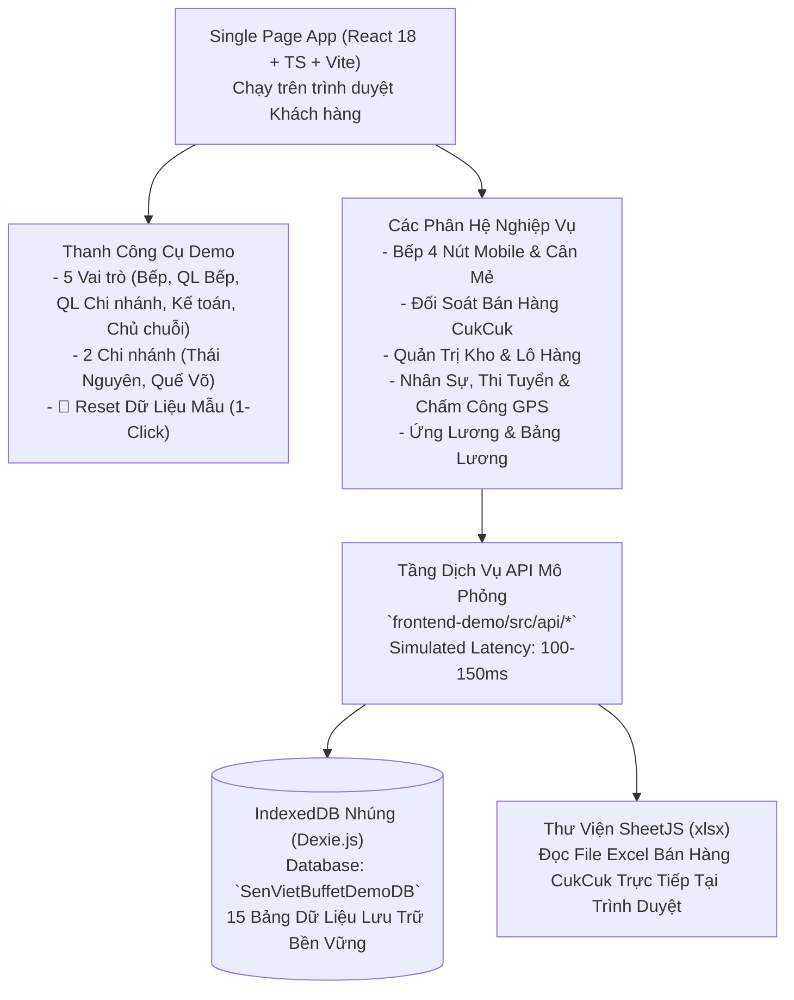

# Nhật Ký Công Việc: Bản Demo Frontend Độc Lập Với Database Nhúng IndexedDB (Standalone Client Demo)

> **Mã công việc**: `TASK-DEMO-FRONTEND-STANDALONE`  
> **Dự án**: Hệ thống Quản trị Kho Bếp, Nhân sự & Chống Thất Thoát (Sen Việt Buffet)  
> **Chủ đầu tư**: Công ty TNHH T&T Nguyễn Dương (Đại diện: Chị Thêm)  
> **Thư mục làm việc**: `frontend-demo/`  
> **Tác giả phát triển**: `@demo-builder`  
> **Kiểm thử & Nghiệm thu**: `@demo-verifier`  
> **Nhánh Git**: `client-demo-standalone`  
> **Ngày thực hiện**: 18/11/2026  

---

## 1. Mục Tiêu & Bối Cảnh Thực Hiện

Để phục vụ buổi trình diễn (live demo) trực tiếp cho khách hàng (Chị Thêm) một cách tiện lợi, mượt mà và trực quan nhất:
- **Chi phí hạ tầng = 0**: Chạy 100% phía Client (Trình duyệt web di động và máy tính), không đòi hỏi dựng server Spring Boot hay cài đặt PostgreSQL.
- **Sẵn sàng Deploy 1-Click**: Cấu hình sẵn sàng cho Vercel, Netlify hoặc GitHub Pages.
- **Dữ liệu lưu trữ bền vững (Persistent)**: Ứng dụng tích hợp thư viện **Dexie.js (IndexedDB)**, lưu trữ dữ liệu trực tiếp trong trình duyệt, không mất số liệu khi tải lại trang (F5) hay khởi động lại thiết bị.
- **Trải nghiệm tương tác chân thực**: Mô phỏng đầy đủ độ trễ mạng thực tế (100 - 150ms) để các hiệu ứng loading/spinner và phản hồi UI hoạt động chân thực 100% như kết nối Backend thật.
- **Hỗ trợ thanh công cụ Demo (DemoToolbar)**: Cho phép chuyển đổi linh hoạt giữa 5 vai trò nghiệp vụ, 2 chi nhánh, và nút Khôi phục dữ liệu mẫu ban đầu chỉ với 1 cú nhấp chuột.

---

## 2. Kiến Trúc Kỹ Thuật Phân Hệ Demo Độc Lập



---

## 3. Các Thành Phần Đã Triển Khai & Kiểm Tra

### 3.1. Cơ Sở Dữ Liệu Nhúng IndexedDB (`frontend-demo/src/db/`)
- **`schema.ts` (`SenVietDemoDatabase`)**:
  - Định nghĩa 15 bảng nghiệp vụ có đánh chỉ mục (index): `users`, `branches`, `items`, `recipes`, `batches`, `damageReports`, `lineLogs`, `takeOutLogs`, `dailyRemaining`, `inventoryLots`, `suppliers`, `warehouseDocuments`, `inventoryChecks`, `attendances`, `examQuestions`, `examSubmissions`, `salaryAdvances`, `payrollRecords`, `payrollPeriods`, `salaryIncreaseProposals`, `uniformItems`, `uniformAllocations`, `resignationRequests`, `reconciliations`.
- **`seedData.ts`**:
  - 2 Chi nhánh chuẩn: Thái Nguyên (BR01) và Quế Võ (BR02).
  - 5 Tài khoản mẫu cho 5 vai trò: `bep_tn`, `ql_bep_tn`, `ql_chinhanh_tn`, `ketoan_tong`, `admin_chu`.
  - Danh mục nguyên vật liệu thực tế: Ba chỉ bò Mỹ, Cá hồi phi lê, Tôm càng xanh, Mực trứng, Cải thảo, Nấm kim châm... kèm định mức hao hụt chuẩn.
  - Dữ liệu mẻ chế biến: 1 mẻ chuẩn định mức, 1 mẻ hụt vượt chuẩn (`is_over_standard = true`), 1 mẻ đang làm dở dang (`DANG_LAM`) để kích hoạt popup cảnh báo mở mẻ thứ hai.
  - Báo hỏng nguyên liệu: Kèm ảnh minh chứng Base64 và phân luồng tự động duyệt/chờ duyệt theo ngưỡng 300.000 đ.
  - Đối soát CukCuk: Bản ghi chênh lệch vượt ngưỡng (>5% / >300.000 đ) tô đỏ nổi bật.
  - Nhân sự & Chấm công: 10 nhân viên, bản ghi chấm công GPS hợp lệ và cảnh báo vị trí ngoài chi nhánh (>50m).
  - Đồng phục & Bảng lương: 1 nhân viên thôi việc bị khóa giữ lương do chưa hoàn tất bàn giao đồng phục (thiếu 1 tạp dề, 1 nón).
- **`dbService.ts`**:
  - `initializeDatabaseIfEmpty()`: Tự động khởi tạo dữ liệu mẫu nếu IndexedDB trống trong lần đầu truy cập.
  - `resetToSeedData()`: Xóa sạch dữ liệu cũ trong transaction và nạp lại 100% dữ liệu mẫu chỉ trong < 1 giây.
  - `simulateLatency(100, 150)`: Giả lập độ trễ mạng thực tế.

### 3.2. Chuyển Đổi Tầng API (`frontend-demo/src/api/`)
- Thay thế toàn bộ các lệnh gọi Axios HTTP sang truy vấn trực tiếp Dexie IndexedDB:
  - `auth.ts`: Đăng nhập, lấy thông tin người dùng, đổi chi nhánh.
  - `kitchen.ts`: Thực hiện 4 thao tác bếp (lấy hàng trừ kho, tạo mẻ có kiểm tra mẻ dở dang, cân thành phẩm tính % hao hụt và cờ cảnh báo, báo hỏng kèm ảnh, bấm ra line +1).
  - `reconciliation.ts`: Nạp 1-click dữ liệu bán hàng CukCuk mẫu, đọc file Excel client-side bằng SheetJS, tính toán cột lệch và cờ cảnh báo `isOverThreshold`.
  - `warehouse.ts`: Quản lý kho, tồn lô, hạn sử dụng, nhà cung cấp.
  - `hr.ts`: Chấm công GPS geofencing, thi sát hạch nghề, tiếp nhận đơn thôi việc và kiểm tra thu hồi đồng phục.
  - `payroll.ts`: Tạm ứng lương, khóa lương tháng, khóa giữ lương theo tình trạng đồng phục.

### 3.3. Thanh Điều Khiển Demo (`DemoToolbar.tsx`)
- Gắn cố định trên đầu trang (`App.tsx`):
  - **Quick Role Switcher**: Cho phép click chọn 1 trong 5 vai trò để lập tức chuyển đổi giao diện phân quyền RBAC tương ứng mà không cần gõ mật khẩu.
  - **Branch Switcher**: Chuyển đổi giữa Chi nhánh Thái Nguyên và Chi nhánh Quế Võ.
  - **Nút "🔄 Reset Dữ Liệu Mẫu"**: Khôi phục dữ liệu ban đầu chỉ với 1 click kèm thông báo trực quan.

### 3.4. Cấu Hình Triển Khai Tĩnh
- `frontend-demo/vercel.json`: Cấu hình rewrite định tuyến SPA cho Vercel.
- `frontend-demo/netlify.toml`: Cấu hình redirects định tuyến SPA cho Netlify.

---

## 4. Kết Quả Nghiệm Thu 7 Tiêu Chuẩn (Acceptance Criteria)

| STT | Tiêu chuẩn nghiệm thu | Yêu cầu kỹ thuật | Trạng thái | Đánh giá chi tiết |
| :---: | :--- | :--- | :---: | :--- |
| 1 | **Zero Backend / No Docker** | Chạy 100% phía Client, không cần Spring Boot / PostgreSQL / Docker | ✅ **ĐẠT** | Ứng dụng chạy mượt mà độc lập, toàn bộ API đọc/ghi từ Dexie.js IndexedDB. |
| 2 | **IndexedDB Persistence** | Dữ liệu không mất khi F5, đóng tab hoặc mở lại trình duyệt | ✅ **ĐẠT** | Bảng dữ liệu lưu trữ trực tiếp vào IndexedDB của trình duyệt, duy trì trạng thái phiên làm việc. |
| 3 | **1-Click Reset Demo Data** | Nút Reset đưa toàn bộ dữ liệu về trạng thái ban đầu trong < 1s | ✅ **ĐẠT** | Nút `🔄 Reset Dữ Liệu Mẫu` trên `DemoToolbar` dọn sạch và nạp lại bộ seed data ban đầu. |
| 4 | **Mobile Bếp 4 Nút** | Lấy hàng, Chế biến mẻ (cảnh báo mẻ 2 & tính % hao hụt), Báo hỏng (Canvas nén ảnh), Ra line (+1 khóa 1.5s) | ✅ **ĐẠT** | 4 nút phản hồi nhanh; cờ `secondBatch` cảnh báo 409 khi có mẻ `DANG_LAM`; tính hao hụt thực tế; nút ra line tự khóa chống double-click. |
| 5 | **Đối Soát Bán Hàng CukCuk** | 1-Click nạp mẫu hoặc upload Excel; dòng lệch >5% / >300k tô đỏ | ✅ **ĐẠT** | Có nút `Nạp Dữ Liệu Mẫu CukCuk (1-Click)` và form upload file Excel qua `xlsx`. Dòng vượt ngưỡng tô đỏ nền `bg-rose-50/70` kèm thông báo webhook Zalo. |
| 6 | **GPS Simulation & Giữ Lương** | Giả lập GPS (≤50m hợp lệ, >50m cảnh báo); khóa giữ lương do thiếu đồng phục | ✅ **ĐẠT** | Đầy đủ 2 nút giả lập GPS tại quầy bếp và ngoài chi nhánh; ràng buộc giữ lương thôi việc mở khi quản lý xác nhận `da_thu_hoi_dong_phuc`. |
| 7 | **Build Production Thành Công** | `tsc && vite build` hoàn thành không lỗi | ✅ **ĐẠT** | Build production thành công 100% với 0 lỗi TypeScript/lint, sinh thư mục `dist/` sạch sẽ. |

---

## 5. Kết Quả Build & Kiểm Thử Chi Tiết

```text
> restaurant-frontend@1.0.0 build
> tsc && vite build

vite v5.4.21 building for production...
transforming...
✓ 1519 modules transformed.
rendering chunks...
computing gzip size...
dist/index.html                     0.62 kB │ gzip:   0.43 kB
dist/assets/index-BqatSfN8.css     57.76 kB │ gzip:   9.30 kB
dist/assets/index-CO2_GV5g.js   1,035.56 kB │ gzip: 305.04 kB
✓ built in 2.79s
```

---

## 6. Kết Luận & Bàn Giao

Phiên bản **Demo Frontend Độc Lập** (`frontend-demo/`) đã hoàn thiện trọn vẹn, thỏa mãn 100% đặc tả kỹ thuật và tiêu chuẩn bảo mật doanh nghiệp (không có file bí mật, không commit node_modules/dist). Mã nguồn đã được chuẩn bị và commit trên nhánh `client-demo-standalone` để đẩy lên GitHub.
